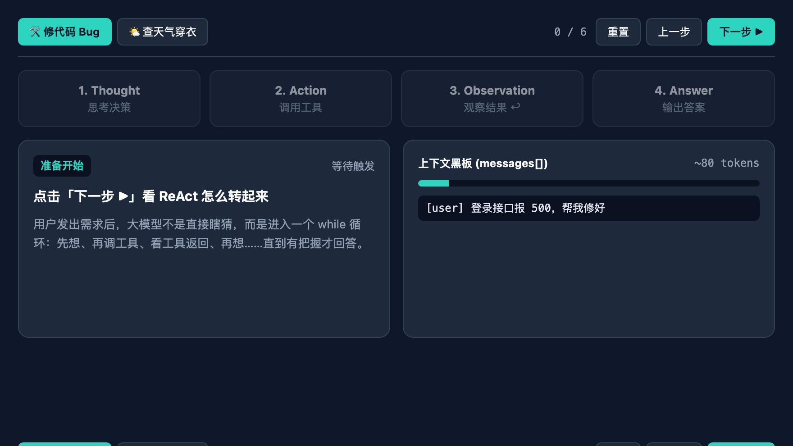
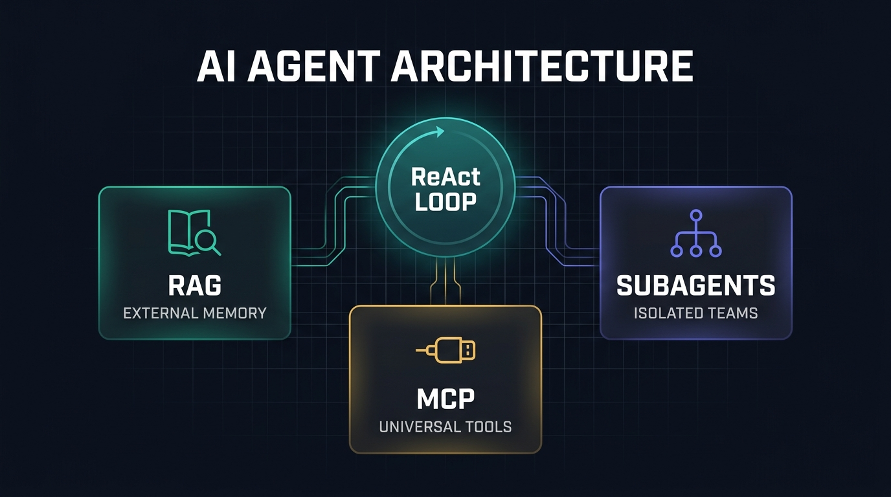

# AI Agent 图文与交互笔记专栏

用**大白话 + 架构图 + 可交互模拟器**，从零拆解现代 AI Agent 的底层工作原理。

> 💡 **在线交互实验室（GitHub Pages）**：开启 Pages 后可直接访问 `https://<你的用户名>.github.io/ai-agent-notes/` 体验所有交互式模拟器。

---

## 目录

| 章节 | 笔记正文 | 在线交互 Demo | 核心图解 |
|---|---|---|---|
| **01** | [ReAct Loop：AI Agent 的底层心脏](notes/01-react-loop.md) | [ReAct Loop 模拟器](demos/react-loop.html) | [对比图](assets/react-vs-cot-plan.jpg) · [动图](assets/react-loop-demo.gif) |
| **02** | [让 Agent 变强的三件套：RAG、MCP 与 Subagent](notes/02-mcp-rag-subagent.md) | [三件套交互实验室](demos/agent-tools.html) | [架构图](assets/agent-architecture.jpg) |

---

## 视觉总览





---

## 如何在 Obsidian 中嵌入交互 Demo？

开启 GitHub Pages 后，在任意 Obsidian 笔记中直接粘贴以下 `<iframe>`（无需任何第三方插件）：

```html
<iframe src="https://<你的用户名>.github.io/ai-agent-notes/demos/react-loop.html" width="100%" height="460" style="border:none;border-radius:12px;"></iframe>
```

```html
<iframe src="https://<你的用户名>.github.io/ai-agent-notes/demos/agent-tools.html" width="100%" height="340" style="border:none;border-radius:12px;"></iframe>
```
