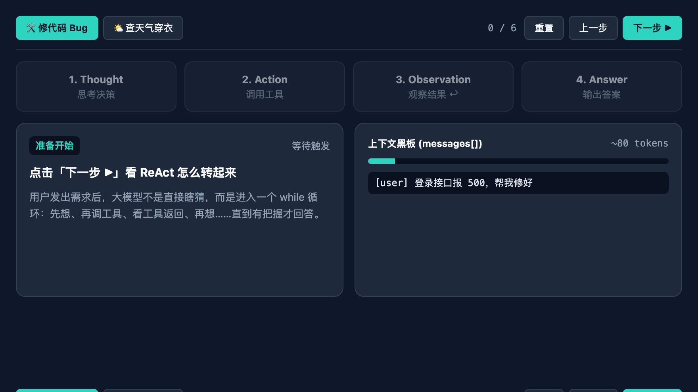
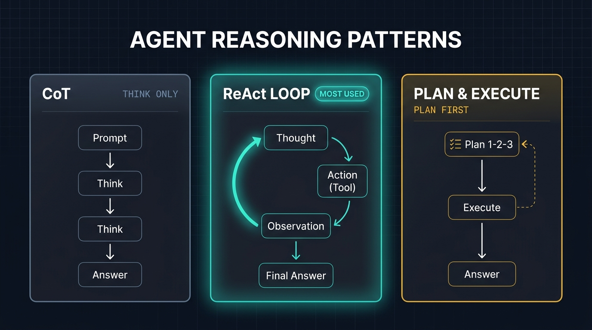
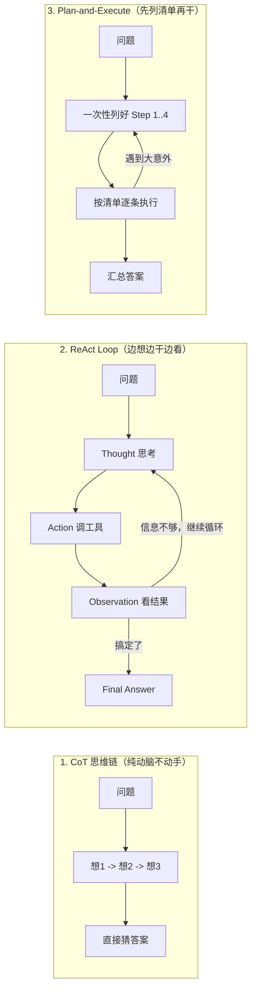

# 01 · ReAct Loop：AI Agent 的底层心脏

> **一句话总结**：**ReAct** = **Re**asoning（推理）+ **Act**ing（行动）。它让大模型从“闭着眼背菜谱”变成“睁开眼做菜”——想一步、调一次工具、看一眼真实结果，再决定下一步，直到任务完成。

- 🎮 **在线交互模拟器**：[打开 ReAct Loop 模拟器](../demos/react-loop.html)



---

## 一、核心运行流程与常见模式对比





### 各模式一句话区分
- **CoT（思维链）**：只动脑不动手，适合纯数学/逻辑题，碰不到外部真实数据。
- **ReAct Loop**：边想、边干、边看真实反馈，动态纠偏能力最强，目前用得最多。
- **Plan-and-Execute（先规划后执行）**：先列完整清单再干，全局感强，但第一步出错后面计划容易作废。
- **Reflection（反思循环）**：像写完作文自己用红笔批改一遍再交卷，常嵌在 ReAct 结束前做质检。
- **ToT（思维树）/ Workflow（固定工作流）**：思维树多分支探索但极烧钱；固定工作流由代码写死步骤，稳定但不够灵活。

---

## 二、代码本质：其实就 10 行 `while` 循环

大模型本身**没有手脚**，不能自己改文件或联网。真正推动它一轮轮转起来的，是外层程序里的这几行伪代码：

```python
messages = [{"role": "user", "content": "帮我修好登录报错"}]

while True:
    # 1. 把整块黑板发给大模型，让它思考（Thought）
    reply = call_llm(messages)
    messages.append(reply)

    # 2. 不调工具了，说明任务完成，退出循环
    if not reply.has_tool_call:
        return reply.text

    # 3. 执行工具（Action），拿到真实反馈（Observation）
    result = run_tool(reply.tool_name, reply.tool_args)

    # 4. 把真实结果追加回黑板，进入下一轮 while
    messages.append({"role": "tool", "content": result})
```

> **为什么 Agent 比普通聊天更费 token？**  
> 每转一轮，`messages[]` 这块“上下文黑板”就会越写越长，下一轮调用 API 时必须把整块黑板从头到尾重新读一遍（重新计算输入 token）。跑十几轮，token 消耗自然成倍往上涨。

---

## 三、为什么 ReAct Loop 用得最多？

1. **容错率最高**：真实世界充满不确定性（比如改完一个 Bug 才知道下一个报错是什么），ReAct 看一步走一步，随时拐弯。
2. **工程极简**：现在主流模型的 API（OpenAI、Claude、Gemini）原生就是围绕这个 `while` 循环设计 Tool Calling 的。
3. **靠证据抑制幻觉**：每一步 Action 都有真实的 Observation 兜底，模型没法凭空瞎编文件内容或执行结果，过程完全可追溯。

---

## 四、实战里的两个“保险丝”

防止 `while True` 死循环把 token 额度烧穿，工程上一定会加两道保险：
1. **最大步数限制（`max_steps`）**：比如最多转 20 轮，到点还没搞定就强制停下来找人类求助。
2. **上下文压缩（Compaction）**：当 `messages[]` 黑板快写满时，自动把早期冗长的工具输出总结压缩，腾出空间继续干活。
