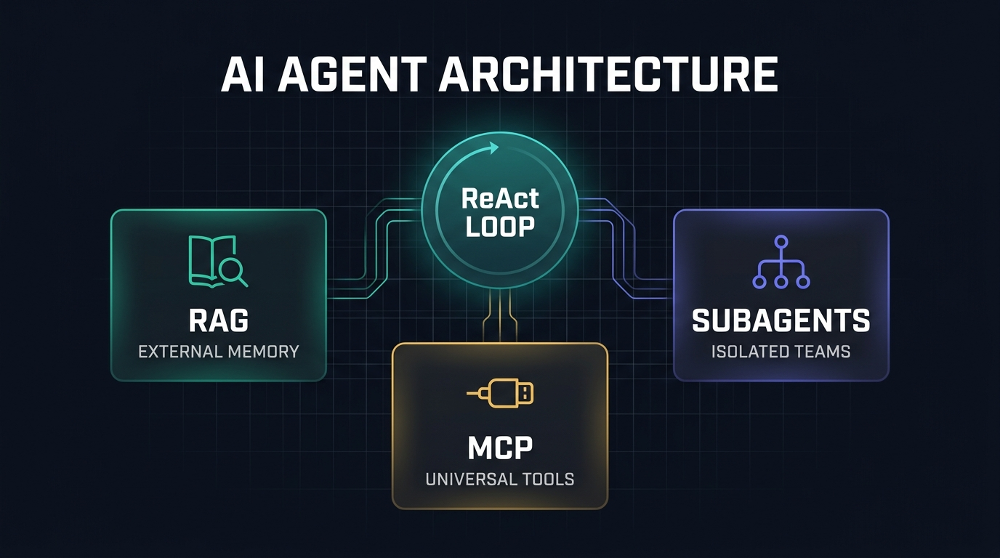
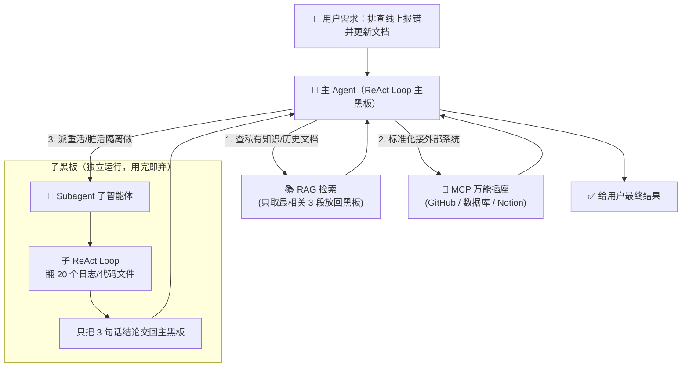

# 02 · 让 AI Agent 真正变强的三件套：RAG、MCP 与 Subagent

> **一句话串联**：如果 **ReAct Loop** 是 Agent 的心脏，那么：
> - **RAG** = 外挂书架（解决私有知识与成本问题）
> - **MCP** = 万能 USB-C 插座（解决工具连接标准化问题）
> - **Subagent** = 分身实习生团队（解决复杂任务上下文污染与并行问题）

- 🎮 **在线交互实验室**：[打开 RAG · MCP · Subagent 实验室](../demos/agent-tools.html)

---

## 一、全局架构图：它们如何配合 ReAct Loop 工作？

---

## 二、核心拆解

### 1. RAG（检索增强生成）= 开卷考试的图书管理员
- **解决什么痛点**：大模型训练完知识就冻结了，且不知道你的私有文档；就算窗口有 1M，每次全塞进 `messages[]` 也又贵又慢，还容易“中间遗忘”。
- **核心做法**：文档切片入库 → 提问时先检索最相关的几段 → 拼进 `messages[]` 让模型参考作答。
- **在现代 Agent 中**：RAG 往往被封装成 ReAct 的一个工具（如 `search_docs`），AI 需要查资料时自己主动去翻。

### 2. MCP（Model Context Protocol）= AI 界的 USB-C 接口
- **解决什么痛点**：以前 N 个 AI 客户端 × M 个外部工具 = 要写 N×M 套胶水代码，换个软件插件全废。
- **核心做法**：统一规范“工具如何自我描述、如何接收参数、如何返回结果”。只要开发一次 **MCP Server**，所有支持 MCP 的客户端（Antigravity、Claude Code、Cursor 等）即插即用。

### 3. Subagent（多智能体协同）= 项目经理 + 专职实习生
- **解决什么痛点**：单一 ReAct 循环干太多杂活（搜 30 个文件、读长日志、改代码、跑测试），几万行中间噪音全堆在同一块 `messages[]` 黑板上，主大脑会越来越糊涂。
- **核心做法**：
  - 主 Agent 把子任务派给 Subagent；
  - 每个 Subagent 拥有**独立的 `messages[]` 小黑板**和独立 ReAct 循环；
  - 干完活后过程噪音直接丢弃，**只把干净结论交回主黑板**，还支持多路并行。
