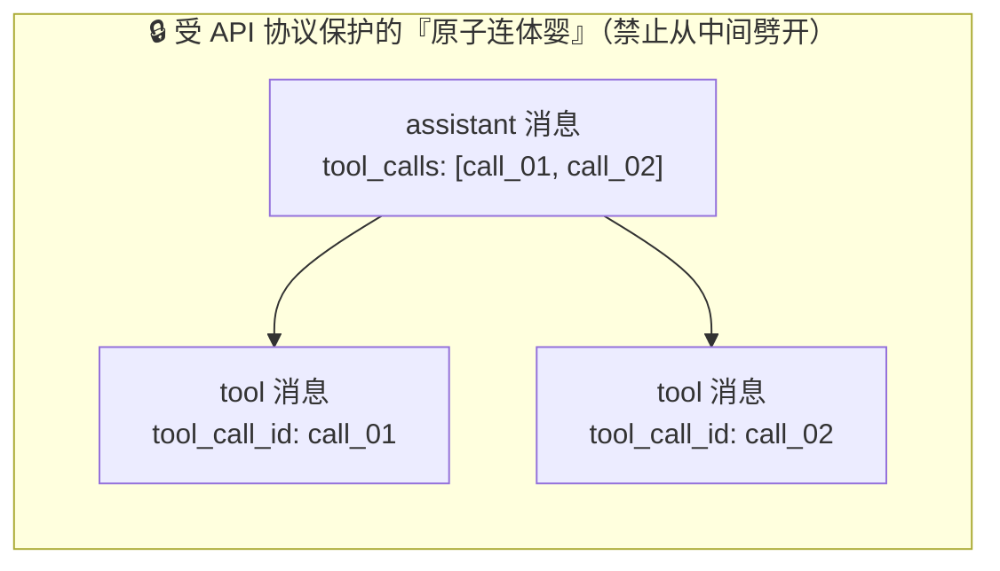
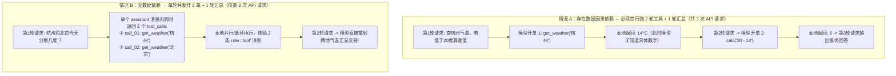
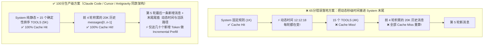

> [!abstract] 核心导读
> 本篇是《手写 30 行 Python ReAct Agent》的进阶姊妹篇。很多开发者能用 SDK 跑通 Demo，却在一线大厂的 Agent / LLM Infra 技术面试中被追问到底层失语。
> 
> 全文完整保留了围绕 `mini_react_agent.py` 展开的 **4 道高强度面试连环追问、真实初版作答盲区、面试官逐字严厉批改与满分标准答案模板**，将上层 Agent 消息编排与底层 **LLM Inference（Incremental Prefill / Decode 显存带宽瓶颈 / Prefix Caching）** 彻底融会贯通。

---

## 一、交互式面试深水区实验室

- 🎮 **在线交互体验**：[**点击进入 ReAct Agent 面试深水区交互实验室 ↗**](https://zhangdingsong.github.io/ai-agent-notes/demos/react-agent-interview.html)

---

## 二、拷问 1：【协议完整性与找 Bug】漏贴点单条会发生什么？

> **面试原题**：在 `mini_react_agent.py` 第 50 行，当大模型返回的只是个点单条（`content` 为 `None`，只有 `tool_calls`）时，如果偷懒删掉 `messages.append(reply)`，只把本地跑出来的 `{"role": "tool", "tool_call_id": "call_9x8a", "content": "14°C，晴"}` 贴在 `user` 消息后面，下一轮请求发给真实大模型 API 时会发生什么？为什么？

### 📝 初版作答实录
> “如果偷懒不把 `content` 为 `null`、只有 `tool_calls` 的消息贴进 `messages[]`，LLM 会没有办法把天气 function 的结果跟某一个 `tool_call_id` 匹配上，具体报什么错不知道。”

### 🔍 面试官逐字批改与底层真相

1. **核心因果判断正确**：没有前序的点单记录，`tool_call_id: "call_9x8a"` 就成了无法溯源的“孤儿回执”。
2. **补全真实报错层级（网关前置拦截，根本进不了 GPU）**：
   这条畸形请求**连大模型推理节点都碰不到**，会在云端 API 网关的 Schema 与状态机校验层被当场拒绝，直接返回 **`HTTP 400 Bad Request`**：
   ```text
   Error code: 400 - Invalid parameter: messages with role 'tool' must be a response to a preceding message with 'tool_calls'.
   ```
3. **双向严格配对约束（面试加分细节）**：
   校验是**双向锁死**的——
   - **缺父节点报 400**：有 `role: "tool"` 却没有紧邻的前置 `assistant(tool_calls)`，报 `400`；
   - **缺子节点同样报 400**：如果 `assistant` 在一轮里并发开了 2 张点单条（`call_01` 和 `call_02`），但你本地只执行或只追加了 `call_01` 的 `role: "tool"` 就急着发起下一轮请求，API 网关同样直接报 `400`（报错提示缺失 `call_02` 对应的工具返回消息）！因此即使某个工具本地执行抛异常报错了，也必须捕获异常并塞回一条 `{"role": "tool", "tool_call_id": "call_02", "content": "Error: ..."}`，绝不能漏回执。



> [!warning] 生产环境头号大坑：上下文压缩（Compaction）的“禁止下刀区”
> 当 Agent 跑到第 20 轮、需要做**滑动窗口截断（Sliding Window）**或**旧历史摘要压缩（Compaction）**时，切分边界必须以**完整轮次单元**对齐，**绝对禁止一刀切在 `assistant(tool_calls)` 和它的 `tool(tool_call_id)` 之间**！一旦切掉了前半截 `assistant` 却留下了后半截 `tool`，整个线上会话会陷入永久性的 `HTTP 400` 死锁。

---

## 三、拷问 2：【执行拓扑】无依赖多任务会跑 2 轮还是 1 轮？

> **面试原题**：如果用户问的是 **“杭州和北京今天分别几度？”**，现代大模型会转 **2 轮**（一轮查一个城市），还是能在**第 1 轮同时开出 2 张点单条**？什么情况下行为会改变？

### 📝 初版作答实录
> “这个问题都有可能，我倾向于 call 两次。”

### 🔍 面试官逐字批改与底层真相

答“都有可能”体现了边界意识，但“倾向于调两次”对现代主流模型的默认能力判断偏落后：**今天的一线商业与开源模型（GPT-4o、Claude 3.5+、Gemini、DeepSeek-V3、Qwen2.5+）默认全部支持 Parallel Tool Calling（并发工具调用），在无依赖场景下第 1 轮就会同时开出 2 张点单条！**

模型选择“多轮串行”还是“单轮并发”，唯一判据是**任务间是否存在数据因果依赖（Data Dependency）**：



### 真实并发点单报文长什么样？
在第 1 轮响应中，模型吐出的单个 `assistant` 消息内部，`tool_calls` 数组直接包含两个元素：

```json
{
  "role": "assistant",
  "content": null,
  "tool_calls": [
    {
      "id": "call_hz_01",
      "type": "function",
      "function": { "name": "get_weather", "arguments": "{\"city\": \"杭州\"}" }
    },
    {
      "id": "call_bj_02",
      "type": "function",
      "function": { "name": "get_weather", "arguments": "{\"city\": \"北京\"}" }
    }
  ]
}
```

这也完美解释了 `mini_react_agent.py` 第 56 行为什么写的是 `for tc in reply["tool_calls"]:`（复数列表遍历），甚至在生产环境中可以用 `asyncio.gather` 把这几个无依赖的 I/O 工具真正**并发异步执行**，把端到端耗时直接砍半，同时省掉整整一轮重读黑板的 API 输入费用。

### 什么时候真的会退化成“分 2 轮调用”？（面试满分补充点）
1. **模型能力受限**：使用了未经多工具并发微调的早期模型或极小参数端侧模型。
2. **人工显式关闭并发控制副作用**：当工具涉及**状态变更或互斥写操作**（例如同时修改同一个文件的不同位置、或者顺序敏感的数据库事务）时，工程师会在 API 请求中主动传入 `parallel_tool_calls: false`，强制模型退化为一轮只开一张单的串行安全模式。

---

## 四、拷问 3：【账单与推理引擎联动】`TOOLS` 算几次钱？Prefix Caching 只做一次 Prefill 吗？挂 100 个工具会怎样？

> **面试原题**：在跑了 **3 轮** 的题目里，`TOOLS` 这份工具菜单一共被算了几次输入 Token 费用？开启 Prefix Caching 后内部是怎么工作的？如果一口气给 Agent 挂载了 100 个超长说明的工具（假设占 30K Tokens），会发生什么？

### 📝 初版作答实录（高频失分靶子）
> “我猜这里的 `TOOLS` 被算了 3 次输入 token 费用，因为 `call_llm` 三次，但是 LLM 内部只会做一次 prefill，可以使用 prefix caching 把公共前缀的 kv cache 缓存在显存或者内存里，每轮都可以复用第一次写好的 kv cache。”

### 🔍 面试官逐字严厉批改（2 处正确 + 4 处硬伤与漏答）

#### ✅ 准确的部分
1. **请求频次与计费统计口径**：3 次无状态 HTTP 请求，`TOOLS` 每次都会由服务端模版序列化拼入 Prompt 前端，3 次均计入 `usage.prompt_tokens`。
2. **多级缓存存储介质**：Prefix Cache 的 KV 张量优先驻留 GPU 显存（VRAM/HBM），显存不足时现代推理引擎（vLLM / SGLang / Mooncake）支持卸载（Offload）至主机内存（CPU DRAM）乃至高速本地 NVMe。

---

#### ❌ 硬伤 1：概念错误——把“跳过前缀重算”说成了“LLM 内部只做一次 Prefill”
**错！3 次 `call_llm` 请求，LLM 内部执行了 3 次 Prefill，绝不是 1 次。**
- **为什么每轮都有 Prefill？**
  第 2 轮请求比第 1 轮新增了 `[assistant(tool_calls), tool(obs)]`；第 3 轮又新增了第 2 轮的工具交互。这些新消息此前从未进过模型，没有现成的 KV Cache。
- **真实推理物理过程（Incremental Prefill）**：
  当第 2、3 轮命中 Prefix Cache 时，推理引擎**跳过了公共前缀部分（`TOOLS` + 旧历史消息）的 QKV 投影与自注意力计算**；但针对本轮**新增的后缀 Token（Delta / Suffix Tokens）**，GPU 依然必须执行 **增量预填充（Incremental Prefill）**——算出新增 Token 的 Q、K、V，并把缓存里前序 Token 的 K、V 读出来与新增 Token 的 Q 做跨位置因果 Attention，从而吐出本轮的第 1 个输出 Token。
- **面试标准表述**：**“公共前缀的 KV 在缓存命中时仅需在第 1 轮计算一次；后续轮次执行增量预填充（Incremental Prefill），只对每轮新增的消息后缀做 Prefill 计算。”**

---

#### ⚠️ 硬伤 2：计费认知粗糙——漏掉了「阶梯折扣单价」与「最低触发阈值」
在面试中只笼统说“算了 3 次输入费用”，会被判定没排查过真实生产账单：
1. **Cache Miss 全价 vs Cache Hit 折扣价**：
   主流商业 API 对命中前缀缓存的部分（`cached_tokens`）既不免单也不收全价——第 1 轮（Cache Miss）收 **100% 标准输入单价**（Anthropic Claude 显式写入缓存收 125%）；第 2、3 轮命中的前缀部分按 **1~5 折优惠单价** 计费（如 OpenAI 5 折、DeepSeek 约 1~2 折、Claude 1 折）。
2. **极易踩坑的隐藏门槛（Minimum Token Threshold）**：
   商业 API 的自动 Prefix Caching 设有**最低前缀长度门槛**！
   - OpenAI：前缀必须 **>= 1024 tokens** 才会启用缓存（低于 1024 tokens 全部 0% 缓存）；
   - Anthropic Claude：按模型规格要求 **1024 ~ 4096 tokens**；
   - DeepSeek：按 64 tokens 粒度分块匹配。
   因此，在我们的 `mini_react_agent.py` 里，2 个工具加起来不到 **150 tokens**，发给 OpenAI 或 Claude 时**连最低缓存门槛都够不着**，3 轮请求实打实全是 Cache Miss 全价重算！

---

#### ⚠️ 硬伤 3：表述过于绝对——“每轮都可以复用 KV Cache”忽略了两大失效前提
面试官一定会反问：**“哪怕 `TOOLS` 定义一字未改，什么情况下第 2 轮也完全复用不了第 1 轮的 KV Cache？”**
1. **严格字节级前缀一致（Exact Prefix Match）**：
   Transformer 的因果注意力机制与 RoPE 旋转位置编码强依赖从第 0 个 Token 开始的精确序列与绝对位置。只要排在 `TOOLS` **前面**的任意内容变了哪怕 1 个 Token（比如在开头的 `System Prompt` 里拼入了秒级时间戳），或者代码用无序集合导致 `TOOLS` 数组内工具顺序发生变动，从第一个差异字符往后的所有 KV Cache **100% 全部失效**。
2. **缓存生命周期（LRU TTL）与分布式路由漂移**：
   云端推理集群的 KV Cache 通常只有 **5~10 分钟空闲 TTL**，超时即被 LRU 淘汰；若高并发下负载均衡器将后续请求调度到了无缓存副本的其他实例池，同样会退化为全量 Prefill。

---

#### ❌ 硬伤 4：审题遗漏——漏答后半问“挂载 100 个超长说明的工具（30K Tokens）会发生什么？”
面试漏答半道题直接丢一半分数。挂 100 个大工具会引发从推理底层到模型智商的 **3 层雪崩**：

1. **推理吐字变慢（即便 100% 命中 Prefix Cache，Decode 阶段依然显著变慢！）**
   很多候选人误以为“命中了 KV Cache 就没有任何性能开销了”——这是典型的没把 **Prefill（算力受限 Compute-bound）** 和 **Decode（显存带宽受限 Memory-bandwidth bound）** 区分清楚！
   - Prefix Cache **只省掉了 Prefill 阶段重算这 30K 工具 KV 的算力**；
   - 一旦进入 **Decode 阶段**（一个字一个字吐点单条或答案），每生成 **1 个新 Token**，GPU 都必须把显存里这 **30K 个工具 Token 的 KV Cache 全量搬运到计算核心**做一次 Attention！前缀多背着 30K 累赘，显存带宽压力剧增，直接导致 **TPOT（每输出一个 Token 的耗时）变慢**，且大块常驻 KV 严重挤压单卡并发吞吐量。
2. **模型路由准确率断崖下跌（Tool Confusion / Lost in the Middle）**
   100 个工具塞满上下文时，大量功能相近的参数描述会严重稀释注意力权重。工程实测表明，单 Agent 直接挂载超过 **20~30 个工具**后，选错工具、漏填必填参数、甚至幻觉编造不存在工具名的概率会急剧上升。
3. **标准工程解法与高阶架构权衡（Trade-off —— 面试冲顶加分项！）**
   - **解法一（职责分治）**：用 **Subagent 架构** 按领域拆分，每个专职子 Agent 只挂 5~10 个高内聚工具。
   - **解法二（按需检索）**：做 **动态工具检索（Tool Search / RAG over Tools）**，根据当前问题只检索最相关的 Top-5 工具挂载。
   - **🔥 高阶架构陷阱**：如果每轮请求都根据问题动态替换顶层的 `TOOLS` 数组，**就会导致每轮请求的前缀都在变，反过来把 Prefix Cache 彻底打碎！**
   - **顶级工程折中方案（如 Claude Code 的 Tool Search 机制）**：保持顶层核心 `TOOLS` 列表（含一个固定的 `tool_search` 元工具）**100% 静态不变以锁死前缀缓存**；当模型需要冷门工具时，调用 `tool_search` 把查到的工具 Schema 作为普通 `role: "tool"` 消息追加在 `messages[]` **尾部**！

---

## 五、拷问 4：【生产级架构设计】静态规则、15 个工具与秒级动态状态如何排布？

> **面试原题**：你在设计一个生产级 Coding Agent，要求模型必须知道“当前精确到秒的系统时间”和“用户当前打开的文件路径（每轮都在变）”，同时系统里有 15 个固定工具（约 4000 Tokens）。
> **请问：为了让 Prefix Caching 命中率最高，你应该把「固定规则 System Prompt」、「15 个 TOOLS 定义」、「动态时间与当前文件路径」按什么先后顺序组织到上下文中？为什么？**

### 📝 初版作答实录（得分：65 / 100）
> “就按这个顺序：「固定规则 System Prompt」、「15 个 TOOLS 定义」、「动态时间与当前文件路径」来组织到上下文中，因为 system prompt 变化最少，tools 定义存在随机变化的可能，而动态时间和当前路径是每一轮都会变化的。同时，这 15 个固定工具 4K token 已经达到了主流厂商的自动 prefix caching 的门槛，在工具不经常变化的情况下，可以省部分 token。”

### 🔍 面试官深度批改：为什么这个回答只能拿 65 分？

你能答出“静态在前、动态在后”并结合 4K 缓存门槛，已经超过了初级水平；但距离生产级架构师要求，还有 **1 个致命落地漏洞 + 2 处专业表述失分**：

#### ❌ 致命漏洞：没指明“动态状态”放进哪个消息结构——若放在 `System` 末尾或消息头部，多轮历史缓存照样全崩！

1. **你无法自由指定 `System` 与 `TOOLS` 的前后物理拼接顺序**：
   在 Chat Completions API 中，`tools` 是独立顶层参数，服务端 Chat Template 硬编码了它与 `system` 的渲染先后（例如 Claude 内部是 `tools → system → messages`，而许多开源模型模版是 `system → tools → messages`）。在后一种模版上，只要你把秒级时间塞在 `role="system"` 的末尾，排在 `system` 后面的 **4K `TOOLS` 缓存依然每轮 100% 报废**。
2. **击穿多轮 ReAct 循环攒下的几万字历史 `messages[]` 缓存（最痛的线上事故！）**：
   别忘了 Agent 是多轮循环的！假设跑到第 5 轮，`messages[]` 黑板上已经积累了前 4 轮读代码文件、查终端日志的 **20K 历史 Tokens**。
   如果你在第 5 轮去更新排在最前面的 `System Prompt`（或第 1 条 `user` 消息）里的秒级时间 `12:12:18`，那么排在这个时间戳后面的 **4K 工具 + 20K 历史对话消息（共 24K Tokens）的 KV Cache 全部作废（Cache Miss）**，每一轮都要重新全量 Prefill！



#### ⚠️ 失分点 2：“TOOLS 定义存在随机变化的可能”
题目明确给定“15 个固定工具”，在工程代码里 **绝对不允许 `TOOLS` 出现随机顺序变化**！严禁用 Python 无序 `set` 组装工具列表或让字典序列化键序漂移，工具注册表必须强制执行 **确定性排序（Deterministic Ordering，如按工具 `name` 字典序固定排列）**。

#### ⚠️ 失分点 3：术语失准——“可以省部分 Token”
**Prefix Caching 连 1 个 Token 都省不了**！请求发出去的 `prompt_tokens` 数量完全不变，依然实打实扣减上下文窗口长度上限，并在 Decode 阶段占用显存带宽。
面试中必须精确表述为：**节省的是「输入 Token 的计费单价（Cached Token 折扣成本）」以及「服务端 Prefill 阶段的计算量与首字延迟（TTFT）」**。

---

### 🏆 面试满分标准答案模板（可直接复述）

> “在生产级 Coding Agent 中，为了最大化多轮 ReAct 循环的 Prefix Cache 命中率，上下文必须按 **『顶层静态完全冻结 + 动态环境状态尾插（Tail Injection）』** 来组织：
> 1. **冻结前缀（`System Prompt` + `15 个 TOOLS`）**：`System Prompt` 不放任何秒级动态变量（若需日期感知，最多放按天不变的 `YYYY-MM-DD`）；15 个工具按名称做**确定性排序**固定序列化。由于服务端模版固定拼接两者且总长超过 4K Tokens，跨过了主流厂商 1024~4096 Tokens 的自动缓存门槛，第 1 轮后即可稳定驻留缓存。
> 2. **保护历史消息链（`messages[0..n-1]` 只增不改）**：前序轮次已产生的 `user`、`assistant`、`tool` 消息严禁在后续轮次做任何原地修改，确保哪怕累积到几万 Token 的历史记录也能逐轮追加命中缓存。
> 3. **动态状态尾插（Tail Injection）**：将每轮实时变化的『精确到秒的时间戳』和『当前打开的文件路径』封装为环境元数据块（如 `<env_context>...</env_context>`），**仅追加在 `messages[]` 数组最后一条新增消息（最新 `user` 提问或最新 `tool` 返回结果）的末尾**。
> 
> 这样每一轮调用时，前面 `System + TOOLS + 全部历史消息` 都能 100% 命中 Prefix Cache，GPU 只需对最末尾几十到几百个新增 Token 做极轻量的 **Incremental Prefill**，大幅压缩多轮计费成本与首字响应延迟（TTFT）。”

---

## 六、考前 3 分钟高密度复习速查表

| 编号 | 核心面试考点 | 候选人高频踩坑表述 | 满分底层机制与工程铁律 |
| :---: | :--- | :--- | :--- |
| **01** | **工具到底是谁执行的？** | “大模型调用了天气函数” | 大模型**绝不执行代码**，只吐出纯文本 JSON 点单条（`tool_calls`）；真正执行函数的是本地循环里的 `TOOL_MAP[name](**args)` |
| **02** | **`content=None` 的点单条能省吗？** | “没正文内容不用存进历史” | **严禁省略**！它是后续 `role: "tool"` 的协议父节点；漏存或少回执任意一张单，API 网关前置校验直接拦回 **`HTTP 400`** |
| **03** | **上下文截断（Compaction）死穴** | “按固定最近 20 条消息直接切片” | `assistant(tool_calls)` 与紧跟的所有 `tool(tool_call_id)` 是**原子连体婴**，一刀切在中间会导致会话永久报 `400` 崩溃 |
| **04** | **多任务调用是串行还是并发？** | “每次只能调一个工具，跑多轮” | 无因果数据依赖时，主流模型默认启用 **Parallel Tool Calling**，单轮单个 `tool_calls[]` 数组并发开多单；有互斥写副作用时可设 `parallel_tool_calls: false` 关闭 |
| **05** | **命中缓存后做几次 Prefill？** | “3 轮请求只做 1 次 Prefill” | **3 轮请求做了 3 次 Prefill**！命中缓存只跳过公共前缀的 KV 重算，每轮新增后缀仍须执行 **Incremental Prefill（增量预填充）** |
| **06** | **Prefix Caching 怎么计费？** | “命中的前缀免费 / 收 3 次全价” | 既不免费也不是全价：第 1 轮 Cache Miss 全价（Claude 显式写 1.25x），后续命中收 **1~5 折折扣价**；且有 **1024~4096 tokens 最低触发门槛**，太短则全程 0% 命中 |
| **07** | **Prefix Caching 省了什么？** | “省了不少输入 Token” | **输入 Token 数量 1 个不少**（照占窗口上限）；省的是 **API 计费成本（Cost）** 与 **服务端 Prefill 算力 / 首字延迟（TTFT）** |
| **08** | **挂 100 个大工具开了缓存还慢吗？** | “既然缓存命中了就不会变慢” | **Decode 阶段照样变慢**！Decode 是 **显存带宽受限（Memory-bandwidth bound）**，每吐 1 个字都要搬运 30K 工具 KV Cache，拉高 **TPOT**，还会引发 **Tool Confusion** 选错工具 |
| **09** | **动态工具检索（Tool Search）副作用** | “每轮只挑 Top-5 工具塞进 `TOOLS` 最完美” | 每轮动态替换顶层 `TOOLS` 会**改写前缀、打碎 Prefix Cache**！高阶解法是冻结顶层核心 `TOOLS`，把按需检索到的工具说明作为尾部消息注入 |
| **10** | **秒级时间与当前路径放哪里？** | “放在 `System Prompt` 末尾” | 改 `System` 会**连环击穿后续几万字多轮历史 `messages[]` 缓存**！必须冻结 `System + 确定性排序 TOOLS`，将动态状态**尾插（Tail Injection）**在最后一条新增消息末尾 |
