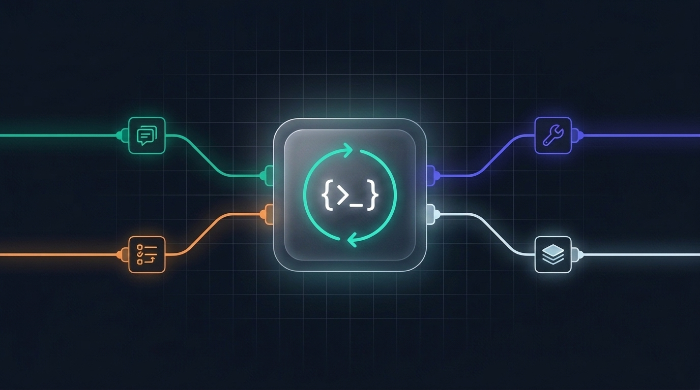
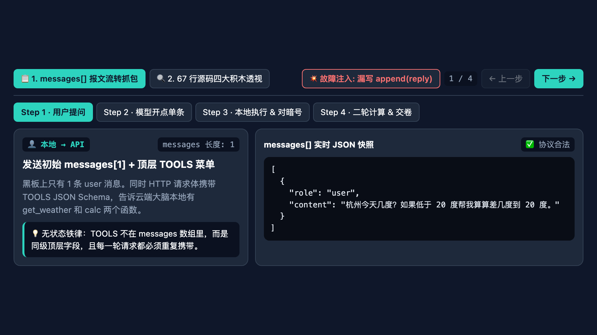
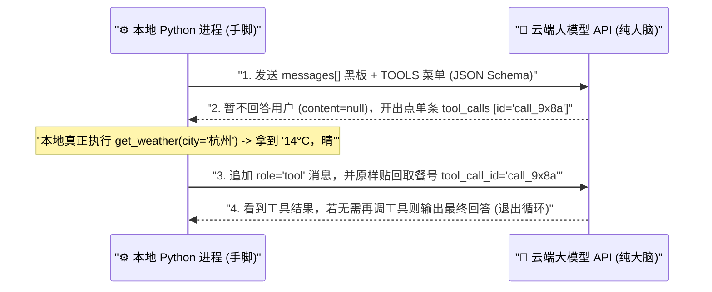
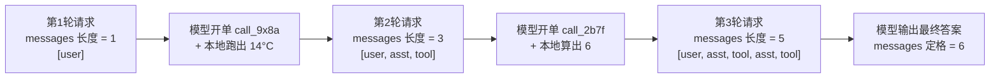

> [!abstract] 核心导读
> 前一篇《ReAct Loop：AI Agent 的底层心脏》用 **10 行 `while` 伪代码** 讲清了 ReAct 的概念骨架；本篇将彻底撕掉所有第三方框架（LangChain / OpenAI SDK）的黑盒包装，用 **零依赖的原生 Python（核心逻辑约 30 行，完整文件 67 行）** 亲手跑通一个真实的 ReAct Agent，并用显微镜逐轮看清 `messages[]` 黑板与 `tool_call_id` 在客户端与云端 API 之间的真实流转。



---

## 一、交互式报文与源码透视实验室

- 🎮 **在线交互体验**：[**点击进入 Mini ReAct Agent 报文与源码实验室 ↗**](https://zhangdingsong.github.io/ai-agent-notes/demos/mini-react-agent.html)



---

## 二、从“10 行伪代码”到“可运行真代码”，中间隔了哪 3 个真实零件？

在概念篇里，我们写过这样一段理想化的伪代码：

```python
while True:
    reply = call_llm(messages)
    messages.append(reply)
    if not reply.has_tool_call:
        return reply.text
    result = run_tool(reply.tool_name, reply.tool_args)
    messages.append({"role": "tool", "content": result})
```

但当你真正动手调用商业大模型 API（OpenAI / DeepSeek / Claude / Gemini）时，立刻会面对一道物理隔离墙：

> **大模型是一个被关在云端机房玻璃房里的“纯大脑”**。
> 它既看不见你本地硬盘上的 `.py` 源码，也绝对不可能顺着网线直接执行你电脑里的 Python 函数。它唯一能做的事，就是**读入一串 JSON 文本，再吐出一串 JSON 文本**。

为了让“云端纯大脑”精确调度“本地 Python 手脚”，真实的 HTTP API 协议在伪代码之上补齐了像**餐厅点餐**一样的 **3 个核心零件**：



### 零件 1：工具菜单（`TOOLS` JSON Schema）—— 给大脑看的“点菜说明书”
你在本地写好了 `def get_weather(city: str)`，但云端模型根本不知道它的存在。因此每次发 HTTP 请求时，除了传对话历史 `messages`，还必须在同级传一个 `tools` 数组，用标准 **JSON Schema** 明确告诉模型三件事：
1. **`name`（菜名）**：函数叫什么名字（如 `"get_weather"`）；
2. **`description`（适用场景）**：什么时候该调这个函数（如 `"查城市实时天气"`）——**这是模型决定调不调、调哪个工具的核心依据**；
3. **`parameters`（填表格式）**：需要传哪些参数、什么数据类型（`string` / `number` / `boolean`）、哪些是必填项（`required`）。

### 零件 2：点单条（`tool_calls` 数组）—— 模型只填表，绝不跑代码
当模型读完用户问题（如“杭州今天几度？”）并扫了一眼 `TOOLS` 菜单后，发现需要查实时天气，它返回的 `assistant` 消息长这样：

```json
{
  "role": "assistant",
  "content": null,
  "tool_calls": [
    {
      "id": "call_9x8a",
      "type": "function",
      "function": {
        "name": "get_weather",
        "arguments": "{\"city\": \"杭州\"}"
      }
    }
  ]
}
```

这里有三个初学者最容易看走眼的细节：
- **`content` 往往是 `null`**（或仅有一句简短过渡语）：因为模型还没拿到真实天气数据，此时无法向用户作答；
- **`arguments` 是一串 JSON 格式的字符串**（注意外层的引号），而不是现成的 Python 字典，本地拿到后必须先用 `json.loads()` 反序列化拆包；
- **`id`（如 `"call_9x8a"`）**：由服务端生成的**唯一取餐号**。

### 零件 3：取餐号对暗号（`tool_call_id`）—— 交回执行结果的凭证
本地 Python 拦截到 `tool_calls`，替模型执行完 `get_weather(city="杭州")` 拿到 `"14°C，晴"` 后，往 `messages[]` 追加 `role: "tool"` 消息时，**必须原样带上刚才那张点单条的 `id`**：

```json
{
  "role": "tool",
  "tool_call_id": "call_9x8a",
  "content": "14°C，晴"
}
```

为什么要专门设计 `tool_call_id`？因为模型在**同一轮里可能同时开出多张点单条**（并发调用多个工具），后续本地把多个执行结果塞回黑板时，模型全靠 `tool_call_id` 对暗号，才能分清哪个结果属于哪次函数调用。

---

## 三、逐行源码拆解：零第三方依赖版 `mini_react_agent.py`

为了不被任何第三方 SDK 黑盒遮挡底层细节，仓库中的 `code/mini_react_agent.py` 完全使用 Python 标准库（`json`、`os`、`urllib.request`）编写，支持**本地仿真模式**与**真实大模型 API 模式**一键切换。

### 完整源码（共 67 行）

```python
"""30 行核心代码看清 ReAct Agent 的真实运转（零第三方依赖版）"""
import json, os, urllib.request

# 1. 本地真正的“手脚”函数 + 工具映射表
def get_weather(city: str) -> str:
    return {"杭州": "14°C，晴", "北京": "8°C，多云"}.get(city, "22°C，阴")

def calc(expr: str) -> str:
    return str(eval(expr, {"__builtins__": {}}))  # 仅作算术演示

TOOL_MAP = {"get_weather": get_weather, "calc": calc}

# 2. 给大模型看的“工具菜单”（JSON Schema）
TOOLS = [
    {"type": "function", "function": {"name": "get_weather", "description": "查城市实时天气",
     "parameters": {"type": "object", "properties": {"city": {"type": "string"}}, "required": ["city"]}}},
    {"type": "function", "function": {"name": "calc", "description": "计算四则算术表达式",
     "parameters": {"type": "object", "properties": {"expr": {"type": "string"}}, "required": ["expr"]}}},
]

def call_llm(messages: list) -> dict:
    """有 API Key 时走真实大模型；未配置时走本地仿真（返回 100% 同款真实报文结构）"""
    api_key = os.getenv("LLM_API_KEY")
    if api_key:
        url = os.getenv("LLM_BASE_URL", "https://api.deepseek.com/chat/completions")
        model = os.getenv("LLM_MODEL", "deepseek-chat")
        body = json.dumps({"model": model, "messages": messages, "tools": TOOLS}).encode()
        req = urllib.request.Request(url, data=body, headers={
            "Authorization": f"Bearer {api_key}", "Content-Type": "application/json"
        })
        with urllib.request.urlopen(req, timeout=30) as resp:
            return json.loads(resp.read())["choices"][0]["message"]

    # --- 本地仿真模式：原汁原味复现大模型 3 轮返回报文 ---
    n = len(messages)
    if n == 1:
        return {"role": "assistant", "content": None, "tool_calls": [
            {"id": "call_9x8a", "type": "function", "function": {"name": "get_weather", "arguments": '{"city": "杭州"}'}}]}
    if n == 3:
        return {"role": "assistant", "content": None, "tool_calls": [
            {"id": "call_2b7f", "type": "function", "function": {"name": "calc", "arguments": '{"expr": "20 - 14"}'}}]}
    return {"role": "assistant", "content": "杭州今天 14°C（晴），低于 20°C，距离 20°C 还差 6 度。"}

# 3. 核心 ReAct Loop（对应 01 笔记里的 while 循环 + max_steps 保险丝）
def run_agent(user_prompt: str, max_steps: int = 5):
    messages = [{"role": "user", "content": user_prompt}]
    for step in range(1, max_steps + 1):
        print(f"\n========== 第 {step} 轮思考 (当前黑板共 {len(messages)} 条消息) ==========")
        reply = call_llm(messages)
        messages.append(reply)  # 把模型的回复（哪怕是点单条）原样贴上黑板

        if not reply.get("tool_calls"):  # 没点单 = 大功告成！
            print(f"✅ [Final Answer]: {reply['content']}")
            return messages

        for tc in reply["tool_calls"]:   # 逐张处理模型开出的点单条
            fn_name = tc["function"]["name"]
            fn_args = json.loads(tc["function"]["arguments"])
            print(f"🛠️  [Action] 模型点单: {fn_name}({fn_args}) | 取餐号: {tc['id']}")
            obs = TOOL_MAP[fn_name](**fn_args)
            print(f"👀 [Observation] 本地执行结果: {obs}")
            messages.append({"role": "tool", "tool_call_id": tc["id"], "content": obs})

if __name__ == "__main__":
    final_board = run_agent("杭州今天几度？如果低于 20 度帮我算算差几度到 20 度。")
    print("\n📜 最终完整 messages[] 黑板 JSON：")
    print(json.dumps(final_board, ensure_ascii=False, indent=2))
```

---

### 四大积木块逐块透视

#### 模块 ①：本地手脚与字符串路由表（第 4–11 行）
- **为什么工具返回值统一转成 `str`（如 `str(eval(...))`）？**
  因为工具执行结果最终要塞进 `{"role": "tool", "content": obs}` 作为文本消息喂回给大模型阅读。若直接塞入整数 `6` 或原始 Python 对象，部分严格校验 Schema 的 API 网关会直接报字段类型错误，统一序列化为 `str`（或 JSON 字符串）是最稳妥的工程规范。
- **为什么需要 `TOOL_MAP` 字典？**
  大模型吐回来的 `tc["function"]["name"]` 只是一段纯文本字符串 `"get_weather"`，Python 无法直接对字符串加括号调用，必须靠 `TOOL_MAP["get_weather"]` 查表定位到内存里的真实函数对象。
- **工程痛点与 MCP 伏笔**：这里只有 2 个简单函数，手写函数 + 维护 `TOOL_MAP` + 再手抄一遍下面的 `TOOLS` JSON 菜单尚可接受；但如果要接入 GitHub、PostgreSQL、Notion 等 50 个外部工具，每个客户端都重复写这套胶水代码就会陷入维护地狱——**后续要实战配置的 MCP（Model Context Protocol），本质上就是把「自动汇报 `TOOLS` 菜单 + 跨进程转发 `TOOL_MAP` 执行」标准化成了通用协议**。

#### 模块 ②：工具菜单 `TOOLS`（第 14–19 行）
- 采用业界通用的 OpenAI Function Calling 结构：外层声明 `"type": "function"`，内层包含 `"name"`、`"description"` 与标准 JSON Schema `"parameters"`。
- **无状态重复携带**：大模型 HTTP 接口本身是无状态（Stateless）的，服务端不会替你记住上一轮传过的工具定义。因此第 1 轮、第 2 轮、第 3 轮请求都必须在请求体里完整带上 `TOOLS`。

#### 模块 ③：大脑通信 `call_llm`（第 21–42 行）
- 剥掉 SDK 外衣后，与大模型通信只是一次标准的 `HTTP POST`：
  - **请求体核心三要素**：`model`（模型标识）、`messages`（当前整块上下文黑板）、`tools`（工具菜单）；
  - **响应体提取路径**：解析返回的 JSON，直接取 `choices[0]["message"]`。
- **双模无缝切换**：未设置环境变量 `LLM_API_KEY` 时走第 35–42 行的离线仿真分支，返回字典的字段层级与真实大模型 API 响应 **100% 同构**；设置 `LLM_API_KEY` 后无需改一行代码即可直连真实云端模型。

#### 模块 ④：18 行 ReAct 心脏引擎 `run_agent`（第 45–62 行）
这就是所有现代 Agent 产品（Claude Code、Cursor、LangGraph、Antigravity）剥到最里层的那颗核心引擎：
1. **第 47 行 `for step in range(1, max_steps + 1):`**：用带上限的 `for` 循环替代裸 `while True`，构成防止死循环烧穿账单的第一道工程保险丝。
2. **第 50 行 `messages.append(reply)`**：**核心铁律**——拿到模型返回的 `message` 字典后，无论它是最终文本回答，还是 `content` 为 `None` 的点单条，都必须第一时间原封不动贴上 `messages[]` 黑板。
3. **第 52 行 `if not reply.get("tool_calls"):`**：循环终止条件。没有点单条即代表模型已完成全部推理，打印并返回最终结果。
4. **第 56–62 行 `for tc in reply["tool_calls"]:`**：遍历本轮所有点单条 → `json.loads` 将参数字符串还原为 Python 字典 → `TOOL_MAP[fn_name](**fn_args)` 解包执行本地函数 → 将观测结果连同对应的 `tool_call_id` 追加回 `messages[]`，进入下一轮思考。

---

## 四、显微镜看黑板：`messages[]` 从 1 条长到 6 条的全生命周期

在终端执行 `python3 code/mini_react_agent.py`，输出如下：

```text
========== 第 1 轮思考 (当前黑板共 1 条消息) ==========
🛠️  [Action] 模型点单: get_weather({'city': '杭州'}) | 取餐号: call_9x8a
👀 [Observation] 本地执行结果: 14°C，晴

========== 第 2 轮思考 (当前黑板共 3 条消息) ==========
🛠️  [Action] 模型点单: calc({'expr': '20 - 14'}) | 取餐号: call_2b7f
👀 [Observation] 本地执行结果: 6

========== 第 3 轮思考 (当前黑板共 5 条消息) ==========
✅ [Final Answer]: 杭州今天 14°C（晴），低于 20°C，距离 20°C 还差 6 度。
```

观察黑板消息条数按 **`1 → 3 → 5 → 6`** 阶梯式生长的轨迹：



程序结束时打印出的完整 `messages[]` JSON 快照如下（重点留意两处 `id` ⇄ `tool_call_id` 配对而成的“连体婴”结构）：

```json
[
  {
    "role": "user",
    "content": "杭州今天几度？如果低于 20 度帮我算算差几度到 20 度。"
  },
  {
    "role": "assistant",
    "content": null,
    "tool_calls": [
      {
        "id": "call_9x8a",
        "type": "function",
        "function": {
          "name": "get_weather",
          "arguments": "{\"city\": \"杭州\"}"
        }
      }
    ]
  },
  {
    "role": "tool",
    "tool_call_id": "call_9x8a",
    "content": "14°C，晴"
  },
  {
    "role": "assistant",
    "content": null,
    "tool_calls": [
      {
        "id": "call_2b7f",
        "type": "function",
        "function": {
          "name": "calc",
          "arguments": "{\"expr\": \"20 - 14\"}"
        }
      }
    ]
  },
  {
    "role": "tool",
    "tool_call_id": "call_2b7f",
    "content": "6"
  },
  {
    "role": "assistant",
    "content": "杭州今天 14°C（晴），低于 20°C，距离 20°C 还差 6 度。"
  }
]
```

---

## 五、小结与下一篇深水区预告

读懂这 67 行代码后，你已经亲眼看清了 ReAct Agent 最本质的运转机制。但如果在技术面试中，面试官顺着这份代码往下深挖，往往会立刻抛出 **4 道连环追问**：

1. **协议与容错**：如果删掉第 50 行的 `messages.append(reply)` 会报什么错？这对生产环境的 **Compaction（上下文截断压缩）** 意味着什么死穴？
2. **并发拓扑**：如果问“杭州和北京今天分别几度？”，模型是串行跑 2 轮还是 1 轮同时开 2 单？什么时候并发会失效？
3. **推理引擎与账单联动**：跑 3 轮请求，`TOOLS` 算几次钱？开启 **Prefix Caching** 后内部真的“只做 1 次 Prefill”吗？如果挂载 100 个大工具（30K Tokens），为什么即便 100% 命中缓存，吐字速度（TPOT）依然会变慢？
4. **生产级上下文架构**：当系统既有 15 个固定工具，又有每秒跳动的系统时间与当前打开文件路径时，怎么排布上下文才能不把 20K 历史对话的 KV Cache 击穿？

这四个高强度实战与面试考点，将在下一篇姊妹笔记 **《ReAct Agent 面试深水区：并发调用、Prefix Caching 与上下文架构》** 中逐字拆解。
