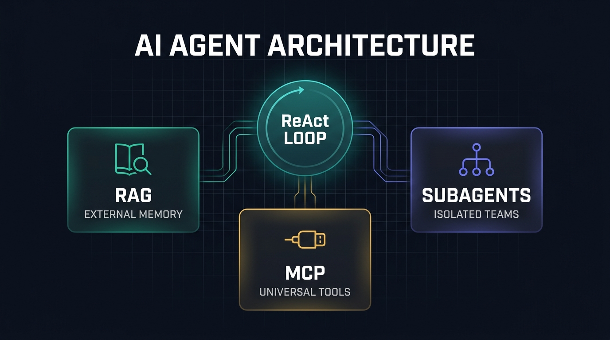
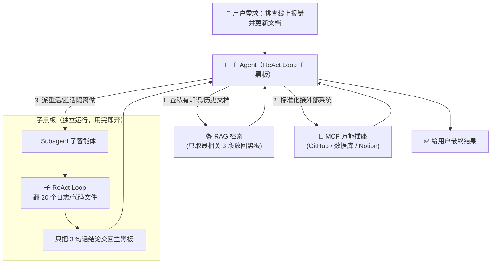

> [!abstract] 一句话串联

> 如果 **ReAct Loop** 是 Agent 的心脏，那么：

> - **RAG** = 外挂书架（解决私有知识与成本问题）

> - **MCP** = 万能 USB-C 插座（解决工具连接标准化问题）

> - **Subagent** = 分身实习生团队（解决复杂任务上下文污染与并行问题）

  

---

  

## 一、交互实验室

- 🎮 **在线交互体验**：[**点击进入 RAG · MCP · Subagent 实验室 ↗**](https://zhangdingsong.github.io/ai-agent-notes/demos/agent-tools.html)

  

---

  

## 二、全局架构图：它们如何配合 ReAct Loop 工作？

  

  

---
上一篇聊完，AI Agent 的底层心脏其实就是个 10 行代码的 **ReAct Loop**。

但光靠一个光杆司令跑 `while` 循环，很快就会撞上三大天花板：

1. 私有文档太多，全塞进上下文又贵又容易“中间遗忘”；
2. 外部工具接口五花八门，接一个改一套代码；
3. 复杂任务搜完几十个文件，单块黑板被噪音塞爆，AI 干着干着就糊涂了。

真正让现代 AI Agent 变强的，是装在 ReAct 外面的**“外挂三件套”：RAG、MCP 和 Subagent**👇

**1. RAG（检索增强生成）= 开卷考试的图书管理员** 大模型训练完知识就冻结了，也不认识你公司的私有文档。就算上下文支持到 100 万 token，每次问小问题都把 500 页手册硬塞进去，既烧钱又慢。 RAG 的做法是：**先检索、再作答**。先把资料切片入库，提问时只精准抽出最相关的 3 段放上 `messages[]` 黑板，省钱 99% 且有据可查。在现代 Agent 里，RAG 往往直接作为 ReAct 的一个工具存在，AI 觉得信息不够就自己去翻书。

**2. MCP（Model Context Protocol）= AI 界的 USB-C 万能插座** 以前 N 个 AI 客户端接 M 个工具，得写 N×M 套胶水代码。MCP 统一规定了“工具如何自我介绍、怎么接收参数、怎么返回结果”。 只要工具方写好一个 **MCP Server**（GitHub、Notion、数据库、Figma），任何支持 MCP 的客户端（Antigravity、Claude Code、Cursor 等）**插上就能直接用**，彻底告别重复造轮子。

**3. Subagent（多智能体协同）= 项目经理 + 专职实习生** 单一 ReAct 循环如果既要翻 30 个文件、又要改代码写测试，几万行中间过程日志全堆在同一块 `messages[]` 黑板上，主大脑很快就会被噪音淹没。 Subagent 的核心思想是**“隔离黑板、只交结论”**： 主 Agent 当经理，把调研或脏活派给子 Agent；每个子 Agent 在自己独立的小黑板里跑完自己的 ReAct Loop，干完活把过程噪音全部扔掉，**只把 3 句话结论汇报回主黑板**——主对话保持清爽，还能多路并行干活。

---

**一句话串联整套现代 Agent 架构：**

- **ReAct Loop** 是心脏，负责边想边干；
- **RAG** 是外挂书架，解决私有知识与成本；
- **MCP** 是万能插座，解决外部工具标准化；
- **Subagent** 是分身团队，解决复杂任务的上下文污染与并发。
  

## 三、核心拆解

  

### 1. RAG（检索增强生成）= 开卷考试的图书管理员

- **解决什么痛点**：大模型训练完知识就冻结了，且不知道你的私有文档；就算窗口有 1M，每次全塞进 `messages[]` 也又贵又慢，还容易“中间遗忘”。

- **核心做法**：文档切片入库 → 提问时先检索最相关的几段 → 拼进 `messages[]` 让模型参考作答。

- **在现代 Agent 中**：RAG 往往被封装成 ReAct 的一个工具（如 `search_docs`），AI 需要查资料时自己主动去翻。

  

### 2. MCP（Model Context Protocol）= AI 界的 USB-C 接口

- **解决什么痛点**：以前 N 个 AI 客户端 × M 个外部工具 = 要写 N×M 套胶水代码，换个软件插件全废。

- **核心做法**：统一规范“工具如何自我描述、如何接收参数、如何返回结果”。只要开发一次 **MCP Server**，所有支持 MCP 的客户端（Antigravity、Claude Code、Cursor 等）即插即用。

  

### 3. Subagent（多智能体协同）= 项目经理 + 专职实习生

- **解决什么痛点**：单一 ReAct 循环干太多杂活（搜 30 个文件、读长日志、改代码、跑测试），几万行中间噪音全堆在同一块 `messages[]` 黑板上，主大脑会越来越糊涂。

- **核心做法**：

- 主 Agent 把子任务派给 Subagent；

- 每个 Subagent 拥有**独立的 `messages[]` 小黑板**和独立 ReAct 循环；

- 干完活后过程噪音直接丢弃，**只把干净结论交回主黑板**，还支持多路并行。