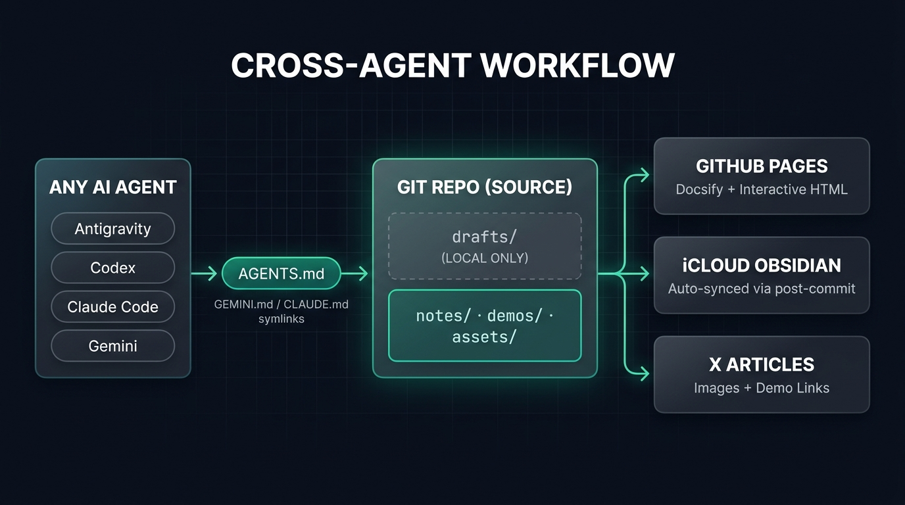
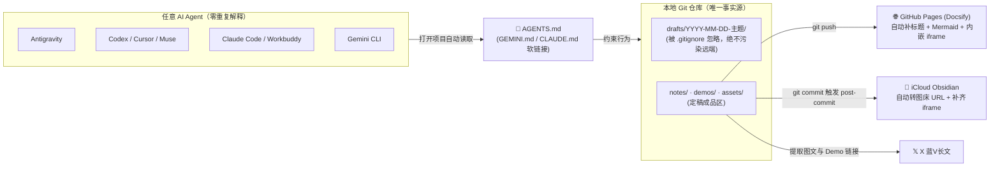

在多台电脑之间切换工作，或者今天用 **Antigravity**、明天用 **Codex / Claude Code / Gemini / Muse Code**，同时还希望笔记能**一处编写、三端分发**（GitHub Pages 专栏 + Obsidian 个人知识库 + X 长文），最容易踩的坑就是：

1. 每换一个 AI 工具，就要把目录规范和避坑要求重新交代一遍；
2. 对话过程中产生的临时草稿和废图，一不小心就会污染 GitHub 和 Obsidian；
3. 换一台新电脑后，本地脚本和自动化配置全丢了。

这套**跨设备、跨 Agent 的知识库工程化编排方案**，就是为了彻底解决这三个痛点。

---

## 一、整体架构：单一事实源 + 三端自动分发

---

## 二、核心设计原理（为什么这样设计？）

### 1. 用“软链接 + 单一规范源”统一所有 AI 工具
不同 AI 工具在打开项目目录时，默认读取的规则文件名各不相同：
- OpenAI Codex、Cursor、Muse 等默认读 **`AGENTS.md`**；
- Google Gemini 系列默认读 **`GEMINI.md`**；
- Anthropic Claude Code、Workbuddy 等默认读 **`CLAUDE.md`**；
- Antigravity 还会自动扫描 **`.agents/rules/*.md`**（设为 `trigger: always_on`）。

如果同时维护三四份文本，改一处就会忘了改另一处。因此我们只把完整规范写进 **`AGENTS.md`**，然后用操作系统原生的**符号链接（Symlink）**让 `GEMINI.md` 和 `CLAUDE.md` 直接指向 `AGENTS.md`（Git 原生支持保存和还原软链接），实现了**“改一份文件，全平台 AI 同步更新”**。

### 2. 用“双区物理隔离”防止中间草稿污染
AI 对话天然会产生大量试错产物（半成品 Markdown、实验 HTML、拆帧临时图）。如果和正式内容混在一起，很快就会失控。
- **草稿区（`drafts/`）**：写进 `.gitignore`，并且按 `drafts/YYYY-MM-DD-<主题>/` 分文件夹存放。无论怎么试错，**Git 永远不追踪、Obsidian 永远不同步**。
- **发布区（`notes/`、`demos/`、`assets/`）**：只有明确拍板“定稿”才移入。

### 3. 一份正文，三端自动适配格式
同一个交互式 HTML，在不同平台上的展示限制完全不同：
- **GitHub 仓库网页**：出于安全策略会屏蔽 `<iframe>`，只能写干净的链接和相对路径图片（`../assets/xxx`）。
- **GitHub Pages（Docsify）**：通过 `index.html` 的前端脚本，自动在网页阅读时把文件名补成一级大标题、渲染 Mermaid 流程图，并把 `demos/*.html` 链接实时替换成可点击的 `<iframe>`。
- **Obsidian 本地笔记**：没有 Docsify 脚本，需要真实的 `<iframe>` 标签和公网图片 URL。于是我们在 `scripts/post-commit.py` 里做了**自动格式转换**——每次 `git commit` 时，脚本自动把 `../assets/...` 转成 `https://.../assets/...` 并补上 `<iframe>`，单向投递进 iCloud Obsidian 仓库。

### 4. 把本地 Hook 变成可随 Git 同步的脚本
Git 本身出于安全考虑不会同步 `.git/hooks/`。为了跨设备无缝迁移，我们把逻辑写进 `scripts/post-commit.py`（用 `Path.home()` 动态获取当前电脑的用户名目录，不写死路径），并配一个 3 行的 `scripts/setup.sh`。换新电脑 `git clone` 后只需跑一次 `./scripts/setup.sh` 即可恢复全部自动化能力。

---

## 三、这套方案的 4 个核心优势

1. **换工具不丢记忆**：不管今天用 Antigravity 还是明天换 Codex / Claude Code，打开目录即自动进入同一套工作习惯。
2. **换电脑 30 秒复活**：规则、代码、笔记、脚本全在 Git 里，Obsidian 靠 iCloud 自动同步，Mac / iPad / 手机全端可用。
3. **零冲突、零垃圾**：Git 只管主仓库，iCloud 只收干净的成品 `.md`，彻底避免 `.git` 文件夹放进 iCloud 导致的同步冲突和损坏风险。
4. **一次创作，多平台复用**：写完一篇笔记，GitHub 仓库、GitHub Pages 交互站、Obsidian 知识库、X 长文素材全部同时就位。

---

> 🛠️ **实操恢复步骤**：新电脑或新 Agent 接入请直接查看 [SETUP.md](../SETUP.md)。
